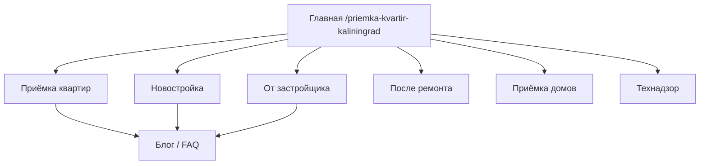

# Обзор семантики и карта страниц

## Бизнес и гео

| Параметр | Значение |
|----------|----------|
| Город | Калининград |
| Область | Калининградская область |
| Wordstat: область | `10857` |
| Wordstat: город | `22` |
| Гео в ключах | Обязательно: *калининград*, *калининградская область*; опционально: *светлогорск*, *зеленоградск*, *советск*, *балтийск*, *гурьевск*, *черняховск* |

## Услуги → кластеры → страницы (черновик)

| Будущая страница (slug) | Кластер | Главный интент | Файл ключей |
|-------------------------|---------|----------------|-------------|
| `/` | Бренд + все услуги | Коммерческий | 01 + 07 |
| `/priemka-kvartir/` | Приёмка квартир | Коммерческий | [01](01-priemka-kvartir.md) |
| `/priemka-kvartiry-v-novostroyke/` | Новостройка | Коммерческий | [02](02-novostroyka.md) |
| `/priemka-kvartiry-ot-zastroyschika/` | От застройщика | Коммерческий | [03](03-ot-zastroyschika.md) |
| `/priemka-kvartiry-posle-remonta/` | После ремонта | Коммерческий | [04](04-posle-remonta.md) |
| `/priemka-domov/` | Дома | Коммерческий | [05](05-priemka-domov.md) |
| `/tehnadzor-remonta-kvartiry/` | Технадзор | Коммерческий | [06](06-tehnadzor-remont.md) |
| `/tseny/` | Цены | Коммерческий | все кластеры |
| `/blog/...` | Статьи | Информационный | [08](08-informatsionnye-zaprosy.md) |

## Типы интентов

| Код | Описание | Куда вести |
|-----|----------|------------|
| **К** | Коммерческий — заказ услуги | Страница услуги + CTA |
| **КГ** | Коммерческий + гео | То же, гео в Title/H1 |
| **И** | Информационный — как, что, образец | Блог / FAQ |
| **ИГ** | Информационный + гео | Блог с локальным блоком |
| **Н** | Навигационный — конкурент/бренд | Не целимся или осторожно |
| **М** | Мусор / не наша услуга | Исключить |

## Приоритеты

| Приоритет | Смысл |
|-----------|--------|
| **P1** | Главные ключи страницы, в Title + H1 |
| **P2** | В подзаголовках, тексте, перелинковке |
| **P3** | Блог, длинный хвост, FAQ |

## Правила для контента (кратко)

1. **Одна главная фраза на страницу** — остальные из смежных кластеров через ссылки, не дублировать H1.
2. **Гео** — в Title/Description/H1 на коммерческих страницах; в тексте — естественно 2–4 раза + область.
3. **Не смешивать** госстройнадзор / Ростехнадзор / вакансии hh — это другой интент ([06](06-tehnadzor-remont.md), минус-слова).
4. **Низкая частота ≠ не писать** — в регионе 5–25 показов/мес по ВЧ уже даёт целевой трафик.
5. **Новые услуги** — новый файл кластера по [шаблону](99-shablon-novoy-uslugi.md).

## Сводка по частотам (ядро, область 10857)

| Группа | Якорная фраза | Показов/мес |
|--------|---------------|------------:|
| Приёмка квартир | приемка квартир | 217 |
| Приёмка + гео | приемка квартиры калининград | 25 |
| Новостройка | приемка квартиры в новостройке | 26 |
| От застройщика | приемка квартиры от застройщика / у застройщика | 16–11 |
| После ремонта | приемка квартиры после ремонта | 7 |
| Дома | приемка домов | 41 |
| Технадзор | технадзор калининград | 19 |
| Стройконтроль | стройконтроль калининград | 46 |
| Строительный контроль | строительный контроль калининград | 26 |

## Семена Wordstat (лог сбора)

`приемка квартир`, `приемка квартир калининград`, `приемка квартиры в новостройке`, `приемка квартиры от застройщика`, `приемка квартиры после ремонта`, `приемка дома`, `технический надзор ремонта`, `технадзор калининград`, `эксперт приемка квартиры`, `строительный надзор`, `строительный контроль ремонт`, `стройконтроль`, `строительный контроль калининград`, `надзор за ремонтом`, `акт приема передачи квартиры`, `акт приемки квартиры`, `приемка квартиры по дду`, `приемка ремонта квартиры`, `приемка квартиры у застройщика`, `специалист по приемке квартир`, `профессиональная приемка квартиры`, `самостоятельная приемка квартиры`, `авторский надзор ремонт`, `независимая приемка квартиры`

Часть запросов вернула пустой ответ API — дубли добраны из смежных семян.

## Что сделать при разработке сайта

- [ ] Проставить финальные URL (slugs) в каждом кластере
- [ ] Написать Title/Description по P1-ключам каждой страницы
- [ ] Связать страницы перелинковкой (новостройка ↔ застройщик ↔ акты)
- [ ] Добавить LocalBusiness schema с адресом в Калининграде
- [ ] При запуске рекламы — отдельные группы под коммерческие кластеры
